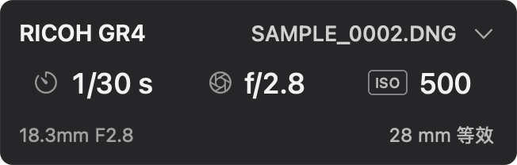
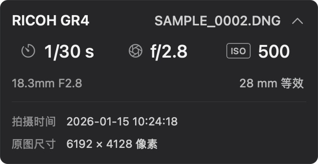

<p align="center">
  
</p>
<h1 align="center">Lightroom Photo Info</h1>
<p align="center"><strong>Your camera settings, alongside your edits.</strong></p>
<p align="center">
  <a href="https://github.com/fishiu/lightroom-photo-info/releases/latest">Download for macOS</a> ·
  <a href="README.md">简体中文</a> ·
  <a href="https://github.com/fishiu/lightroom-photo-info/issues">Report an issue</a>
</p>
<p align="center">
  <a href="https://github.com/fishiu/lightroom-photo-info/actions/workflows/ci.yml"></a>
  <a href="LICENSE"></a>
</p>

A small native **Swift / AppKit** companion for the cloud-based Lightroom desktop app on macOS. Keep camera, lens, shutter speed, aperture and ISO visible while the Edit panel stays open. It follows the selected photo automatically and reads Lightroom's local metadata cache without exporting originals.

This is an independent community tool, not an official Adobe plug-in. The app UI is currently in Simplified Chinese.

| Compact | Expanded |
| --- | --- |
|  |  |

*Rendered from the actual AppKit views with synthetic demonstration data.*

## Features

- Automatically follows photo selection and hides outside Lightroom or in grid/compare views.
- Borderless, draggable overlay that does not take keyboard focus away from editing.
- Camera and filename on top, exposure values in the middle, lens and focal length below.
- Click focal length to switch between actual and 35mm-equivalent values. Estimates are marked `≈`.
- Expand capture time and original pixel dimensions in place.
- Adjust background transparency without fading the text or icons.
- Local and read-only: no photo uploads, telemetry, account or network service in the app.

## Compatibility

| Item | Current scope |
| --- | --- |
| Download | **Apple Silicon** Macs |
| macOS | Deployment target **13+**; runtime tested on **15.7.9** |
| Lightroom | **Cloud-based desktop app**, tested with **9.6**; not Lightroom Classic |
| Library | Cloud photos/albums at the default `~/Pictures/Lightroom Library.lrlibrary/` location |
| Not supported | Local tab, custom/external catalog paths; Intel runtime is untested |
| Lightroom UI matching | Simplified Chinese and English menus; other languages untested |

This is an early release. It depends on Lightroom's private cache format, so Adobe updates may require an adapter update.

## Install

1. Download `Lightroom-Photo-Info-v…-macos-arm64.zip` from [Releases](https://github.com/fishiu/lightroom-photo-info/releases/latest).
2. Extract it and move **Lightroom Photo Info.app** to Applications.
3. Open it and allow **Accessibility** access in System Settings → Privacy & Security.
4. Return to Lightroom and open one photo in Detail/Edit view using the Cloud tab.

**Duplicate filenames inside an album:** Lightroom sometimes draws album scope as search pills absent from its accessibility tree. Use the menu-bar action **相册识别权限…** to grant optional Screen Recording access. When the album label is unavailable, the utility captures only the album sidebar text column or the small search-token region, using only the highlighted sidebar row, recognizes text locally, and never saves or uploads screenshots. Accessible labels remain the preferred path. Unreadable/truncated labels, duplicate album names, and conflicting same-name photos within one album remain unresolved rather than guessed.

**First-launch warning:** releases are ad-hoc signed, without an Apple Developer ID certificate or Apple notarization. After verifying that the download came from this repository, follow [Apple's documented Open Anyway flow](https://support.apple.com/102445) for this app. Disabling Gatekeeper is not required.

If an update still reports missing permission, quit the utility, turn its Accessibility switch off and on, then relaunch it. Lightroom itself does not need a restart.

Optional download integrity check, beside the ZIP and its checksum file:

```bash
shasum -a 256 -c Lightroom-Photo-Info-v0.4.0-macos-arm64.zip.sha256
```

## Use

Drag the overlay to position it. Click focal length to change its display mode. Click the chevron to expand details. The menu-bar aperture icon provides show/hide, **设置…** (Settings), permissions and quit. Launch the utility once before use; it does not install a login item.

Background transparency ranges from 0% (opaque) to 100% (clear) and is saved automatically. Text and icons keep their own opacity.

Recorded equivalent focal length takes priority. For missing values, camera-specific estimates are available for Sony a7C II, Fujifilm GFX100RF, Ricoh GR IV and Fujifilm X100VI. Post-processing crops are not added to these estimates. Other models retain their recorded names and values.

Ambiguous filenames are narrowed by album. The app displays shared values only when all candidates agree; otherwise it reports the ambiguity.

## Build

Requires Xcode Command Line Tools. Uses only Apple frameworks and system SQLite.

```bash
git clone https://github.com/fishiu/lightroom-photo-info.git
cd lightroom-photo-info
./build.sh
./test.sh
ARCH=arm64 ./scripts/package-release.sh
```

The app is written to `build/Lightroom Photo Info.app`. `ARCH=x86_64` is available for source builds but has not been runtime-tested. See [Contributing](CONTRIBUTING.md), [cache adapter notes](docs/catalog-adapter.md), [performance notes](docs/performance.md) and [Changelog](CHANGELOG.md).

Diagnostics can include filenames, album names, paths, capture timestamps and internal asset identifiers. Redact logs before opening an issue; do not upload originals or entire catalogs.

## License

Copyright © 2026 fishiu. Licensed under **[GNU GPL v3.0 only](LICENSE)** (`GPL-3.0-only`).

Lightroom is a trademark of Adobe. This project is independent and is not affiliated with Adobe.

Third-party marks are documented in [image attribution](docs/images/ATTRIBUTION.md).
