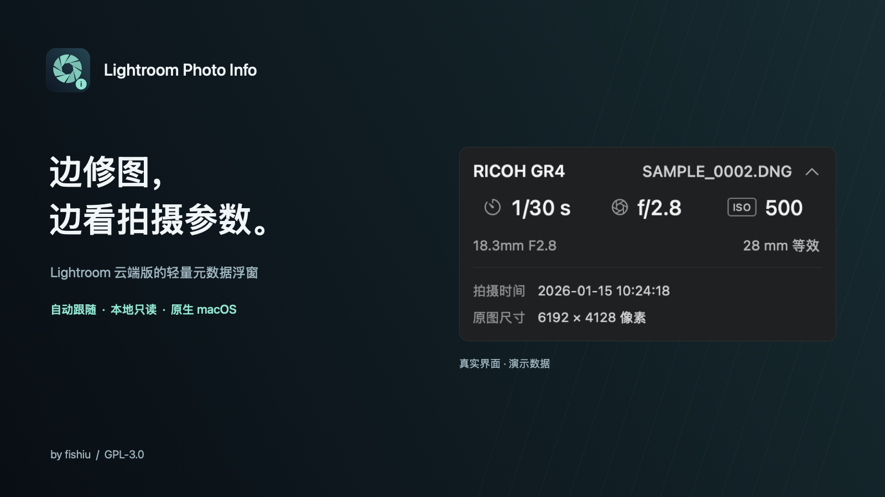
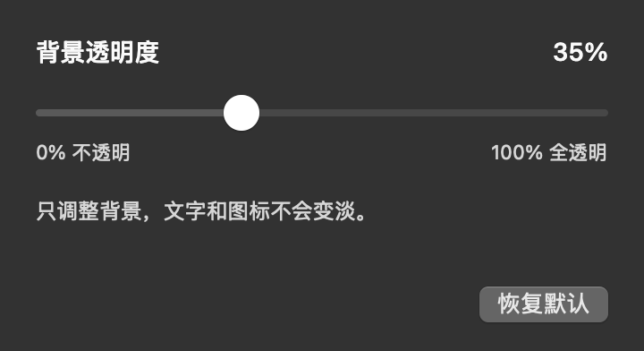

<p align="center">
  
</p>

<p align="center">
  <a href="https://github.com/fishiu/lightroom-photo-info/releases/latest"><strong>下载 macOS 版</strong></a> ·
  <a href="#安装">安装指南</a> ·
  <a href="https://github.com/fishiu/lightroom-photo-info/issues">反馈问题</a> ·
  <a href="README.en.md">English</a>
</p>

<p align="center">
  <a href="https://github.com/fishiu/lightroom-photo-info/actions/workflows/ci.yml"></a>
  <a href="https://github.com/fishiu/lightroom-photo-info/releases"></a>
  
  <a href="LICENSE"></a>
</p>

Lightroom 云端版里，查看拍摄信息常常需要暂时离开编辑面板。**Lightroom Photo Info** 把相机、镜头、快门、光圈和 ISO 放进一个小浮窗，让拍摄参数与修图工具同时留在眼前。

这是一个 **Swift / AppKit 原生 macOS 独立工具**，不是 Adobe 官方插件。无需导出照片，切图时自动跟随，只读本机 Lightroom 缓存。

## 一眼就够

| 日常修图 | 需要时再展开 |
| --- | --- |
|  |  |

*图片由实际 AppKit 界面渲染，采用合成演示数据，不包含私人照片或图库内容。*

- **自动跟随照片**：切图后更新参数；回到网格、最小化或离开 Lightroom 时隐藏。
- **不抢修图焦点**：无标题栏、可拖动，位置随 Lightroom 主窗口移动。
- **清晰的信息层级**：相机与文件名在首行，曝光参数居中，镜头与焦距放在第三行。
- **实际 / 等效焦距切换**：点击焦距即可切换；优先使用照片记录，估算值显示 `≈`。
- **面板内展开**：点击箭头查看拍摄时间与原图像素尺寸，尊重系统“减少动态效果”设置。
- **背景透明度**：菜单栏 → 设置，实时调整背景，文字和图标不会一起变淡。
- **本地、只读**：应用本身不上传照片，没有账号登录、遥测或在线服务。

## 兼容范围

| 项目 | 当前范围 |
| --- | --- |
| 下载包 | **Apple Silicon**（M 系列 Mac） |
| 系统 | 构建目标 **macOS 13+**；实际验证于 **macOS 15.7.9** |
| Lightroom | **云端桌面版**，已验证 **9.6**；不适用于 Lightroom Classic |
| 照片来源 | Cloud / 云端照片和相册；暂不支持 Local / 本地标签 |
| 图库位置 | 默认的 `~/Pictures/Lightroom Library.lrlibrary/` |
| 界面识别 | 简体中文、英文菜单；其他语言未经验证 |

当前是早期版本。应用读取的是 Lightroom 的私有缓存结构，Adobe 更新后可能需要适配。暂不支持自定义或外置图库路径，也未验证 Intel Mac；遇到不兼容情况请提交 Issue。

## 安装

1. 到 **[Releases](https://github.com/fishiu/lightroom-photo-info/releases/latest)** 下载 `Lightroom-Photo-Info-v…-macos-arm64.zip`。
2. 解压，将 **Lightroom Photo Info.app** 移到“应用程序”。
3. 打开应用，按提示在 **系统设置 → 隐私与安全性 → 辅助功能** 中允许 Lightroom Photo Info。
4. 回到 Lightroom 云端版，打开一张照片的细节 / 编辑视图。

**相册里仍提示同名照片？** Lightroom 有时把相册范围画成搜索标签，不向辅助功能提供名称。菜单栏 →「相册识别权限…」可开启可选的屏幕录制权限：工具只在名称缺失时读取 Lightroom 顶部搜索标签的小块区域，在本机识别文字，不保存或上传截图。普通相册优先使用辅助功能。识别不清、相册重名或同相册内仍有同名照片时，会保留无法匹配提示，不猜测照片身份。

**首次打开提示无法验证开发者？** 当前安装包采用本地 ad-hoc 签名，尚无 Apple Developer ID 签名或公证。确认下载来自本仓库后，可按 [Apple 官方说明](https://support.apple.com/102445)，在首次尝试打开后进入“隐私与安全性”，为此应用选择“仍要打开”。不需要关闭 Gatekeeper。

<details>
<summary>更新后权限仍显示开启，但浮窗没有数据</summary>

开发签名会随构建变化。退出工具，在“辅助功能”中将它的开关关闭再开启，然后重新打开工具。无需重启 Lightroom。

如果没有看到浮窗，先检查：Lightroom 是否在前台、是否处于单张照片的细节视图、是否正在使用 Cloud 标签，以及图库是否位于默认路径。菜单栏光圈图标中的“显示拍摄信息”可以恢复手动隐藏的浮窗。

</details>

<details>
<summary>验证下载文件</summary>

Release 同时提供 `.sha256` 文件。在两个文件所在目录运行：

```bash
shasum -a 256 -c Lightroom-Photo-Info-v0.4.0-macos-arm64.zip.sha256
```

校验和用于确认下载完整性，不等同于 Apple 公证。

</details>

## 怎么用

**拖动内容区**调整位置。**点击焦距**切换实际 / 35mm 等效焦距。**点击右上角箭头**展开拍摄时间和原图尺寸。

菜单栏光圈图标提供显示、隐藏、设置和退出。工具需先启动一次；目前不设置开机自启。

<details>
<summary>透明度设置预览</summary>



0% 表示背景不透明，100% 表示全透明；只改变背景及细边框。设置窗口打开时可预览角标，选择会被记住。

</details>

### 关于焦距与相机名称

已有 EXIF 等效焦距时直接使用，不再叠加后期裁切。缺少这一字段时，对 **SONY a7C II、GFX100RF、RICOH GR4、X100VI** 按机型规格估算，并明确显示 `≈`。这四台相机也提供简洁名称；其他机型按元数据记录显示，不做未知的换算。

同名照片会先按相册范围匹配。多个候选只有所有展示字段一致才显示共同参数；不能确认时明确提示，不随便选择一张。

## 开发

只依赖 macOS 系统框架和 SQLite，没有第三方运行时包。需要 Xcode Command Line Tools。

```bash
git clone https://github.com/fishiu/lightroom-photo-info.git
cd lightroom-photo-info
./build.sh
./test.sh
```

构建结果位于 `build/Lightroom Photo Info.app`。默认构建本机架构，最低系统目标为 macOS 13；可用 `ARCH=arm64` 或 `ARCH=x86_64` 指定架构。Intel 构建目前未经运行验证。

```bash
ARCH=arm64 ./scripts/package-release.sh
```

- [贡献指南](CONTRIBUTING.md)
- [元数据读取与匹配机制](docs/catalog-adapter.md)
- [性能测量及边界](docs/performance.md)
- [版本记录](CHANGELOG.md)

诊断输出可能包含文件名、相册名、路径、拍摄时间和内部资源标识。提交 Issue 前请脱敏，不要上传原片、完整图库或未经处理的日志。

## 开源许可

Copyright © 2026 fishiu。项目采用 **[GNU GPL v3.0 only](LICENSE)**（`GPL-3.0-only`）。

Lightroom 是 Adobe 的商标。本项目由社区独立开发，与 Adobe 无隶属关系。

第三方标识的归属与使用说明见[素材声明](docs/images/ATTRIBUTION.md)。
